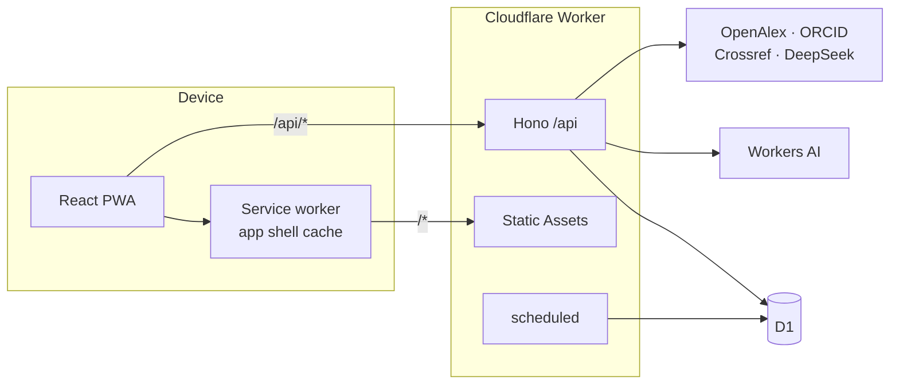
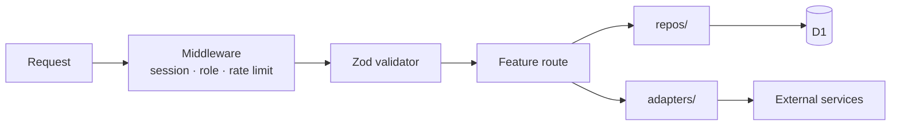
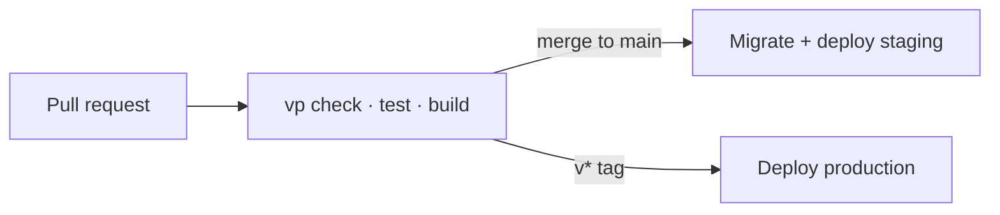

# UniLink

An unofficial, student-run companion PWA for NSU students, whatever their program. It brings course planning, CGPA tracking, class routines, resource sharing, faculty research profiles, rides, lost and found, and a marketplace into one installable app.

## Features

- **Course map**: curriculum with prerequisite checks
- **CGPA & attempts**: graded attempts, retakes and credits
- **Class routine**: weekly schedule with overlap checks
- **Resource sharing**: ask for course materials; students who passed can submit Drive links
- **Ride sharing**: post one-off or recurring rides, select map locations, request seats and coordinate with the driver
- **Inbox and notifications**: private ride chats after acceptance, ride lifecycle alerts and app notifications
- **Faculty profiles**: research data from OpenAlex and ORCID, plus an AI supervisor finder
- **Lost and found, marketplace**: community posts that expire on their own
- **Moderation**: reports, review queue, audit log

### Ride sharing flow

1. A student posts a ride with pickup and destination selected from OpenStreetMap search results, a departure schedule, vehicle details, available seats and a per-seat fare in BDT.
2. Another student requests the number of seats they need. The ride owner reviews the request and accepts or declines it.
3. To accept, the owner supplies the vehicle license plate. The plate is kept out of public ride listings and is shown only to the accepted passenger in their private chat.
4. Acceptance opens a private conversation between the two students. They can coordinate in **Inbox**; when the owner marks the ride finished, the chat is archived. **Notifications** remains a separate feed for ride and other app updates.

Ride location search uses the public OpenStreetMap Nominatim service and map previews use OpenStreetMap. Location searches are explicit (not autocomplete) and the UI displays map attribution. See the [Nominatim usage policy](https://operations.osmfoundation.org/policies/nominatim/) and [tile usage policy](https://operations.osmfoundation.org/policies/tiles/) before changing map behavior or traffic volume.

## Tech stack

| Layer     | Tools                                                               |
| --------- | ------------------------------------------------------------------- |
| Toolchain | [Vite+](https://viteplus.dev) (`vp`), pnpm, TypeScript              |
| Client    | React, Tailwind CSS v4, shadcn/ui, TanStack Router + Query          |
| Forms     | React Hook Form + Zod                                               |
| PWA       | `vite-plugin-pwa` (app shell only, data is always fetched live)     |
| API       | Hono on Cloudflare Workers                                          |
| Database  | Cloudflare D1 (SQLite) + Drizzle ORM                                |
| Auth      | Own sessions table, HttpOnly cookie, WebCrypto PBKDF2               |
| AI        | Workers AI (Clef) for screening, DeepSeek for the supervisor finder |
| Jobs      | Cloudflare Cron Triggers                                            |
| CI/CD     | GitHub Actions + Wrangler                                           |

## Architecture

One Cloudflare Worker serves both the API (`/api/*`) and the built PWA through Static Assets, so everything lives on one origin with no CORS. Each environment (local, staging, production) has its own D1 database.



Inside the server, a request flows through fixed layers:



- **Shared schemas** (`src/shared/schemas/`) are used by both client forms and Hono validators, so each shape is defined once.
- **Repositories** (`src/server/repos/`) hold all SQL. Route handlers never build queries.
- **Adapters** (`src/server/adapters/`) wrap every external service behind an interface with a fake, so tests never hit the network.
- **Limits** (caps, cooldowns, expiries, thresholds) all live in `src/server/limits.ts`.
- Ride offers and seat requests flow through `src/server/features/rides/routes.ts` into `src/server/repos/rides.ts`; accepted requests create participant-scoped chats handled by `src/server/features/chat/routes.ts`. The existing notification feed is shown separately from chat.

### Layout

```
src/
├── shared/    # Zod schemas and helpers used by client and server
├── server/    # Hono app: features/, middleware/, repos/, db/, limits.ts
└── client/    # React app: routes/, components/, lib/
drizzle/       # generated SQL migrations
scripts/       # seed and admin scripts
docs/          # API contracts
```

### Delivery



## Getting started

### Prerequisites

- Node.js 24 (the exact version is recorded in `.node-version`)
- Git
- Vite+ CLI (`vp`), installed on the development machine; Vite+ runs the project scripts and manages the pinned package-manager toolchain

The repository intentionally excludes `node_modules`, package-manager caches and build output. Each machine installs the dependencies locally from the lockfile.

```bash
git clone https://github.com/mdalsami5642/UniLink-v1.git
cd UniLink-v1
vp install
cp .dev.vars.example .dev.vars
vp run db:migrate:local
vp run seed
vp dev
```

The seed step is required for local student course maps: it imports the curriculum catalog and creates demo accounts (`dev_cse` / `dev_bba`). The local demo password is `unilink-dev-2026`.

Run `vp check && vp test && vp build` before opening a pull request. See [CONTRIBUTING.md](CONTRIBUTING.md) for the full setup, commands and git workflow, and [docs/api-contracts.md](docs/api-contracts.md) for the API.
