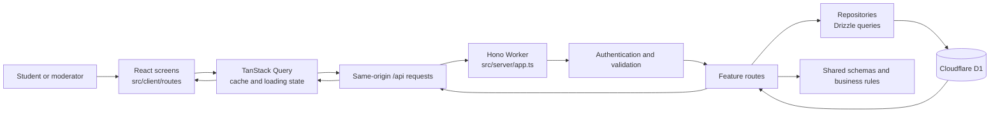

# UniLink: How the App Works

This guide follows a user's action from the screen they tap, through the API and database, and back to the screen. It is written as a presentation outline, with the files to open while explaining each part.

## 1. The app in one picture

UniLink has a browser app and a Cloudflare Worker API. Both use the same shared data rules. The Worker stores application data in Cloudflare D1, a SQLite database.

The main entry points are:

- `src/client/main.tsx` starts React, creates the router and the shared query cache.
- `src/client/routeTree.gen.ts` connects file-based routes. It is generated from `src/client/routes/`.
- `src/server/index.ts` exposes the Hono app as a Worker request handler.
- `src/server/app.ts` attaches API route groups such as authentication, courses, routine, inbox and resources under `/api`.
- `wrangler.jsonc` tells Cloudflare to send `/api/*` requests to the Worker and serve the built web app for other paths. It also configures the D1 binding named `DB`.

## 2. A normal screen load

1. The browser loads the app and `src/client/main.tsx` creates a TanStack Router and QueryClient.
2. A file in `src/client/routes/` renders the requested screen. For example, `src/client/routes/courses.tsx` renders the course map.
3. The screen calls a query declared in `src/client/lib/queries.ts`. TanStack Query tracks whether that data is loading, cached, or failed.
4. The query calls a helper in `src/client/lib/api.ts`. That helper sends a same-origin JSON request such as `GET /api/courses/map` and checks the response with a shared Zod schema.
5. `src/server/app.ts` routes the request to a feature handler. `src/server/middleware/session.ts` reads the session cookie and attaches the signed-in user to the request.
6. The feature route applies access rules, reads or writes through a repository, and returns JSON. The screen receives the validated response and renders it.

The client and server share definitions in `src/shared/schemas/`. This reduces mismatches: the form, API request and database-facing route agree on fields such as a course code, grade or routine time.

## 3. Login and account identity

**Files:** `src/client/routes/login.tsx`, `src/client/lib/auth.ts`, `src/server/features/auth/routes.ts`, `src/server/password.ts`, `src/server/sessionToken.ts`, `src/server/middleware/session.ts`, `src/server/repos/users.ts`, `src/server/repos/sessions.ts`.

When a user submits the login form, the client sends credentials to `/api/auth/login`. The server finds the account, verifies the password hash, creates a random session token, stores only its hash, and sends the token in an HTTP-only cookie. On later API requests, session middleware hashes the cookie token and looks up the matching session. The API then knows which user owns the request without the browser sending a user ID with every operation.

This ownership rule matters for private data: an attempt, routine entry, or inbox item is always read or changed for the signed-in user. Moderators do not automatically get access to a student's private records.

## 4. Course map, completed courses and CGPA

**Main files:** `src/client/routes/courses.tsx`, `src/client/components/courses/CategorySection.tsx`, `src/client/components/courses/CompletedCourses.tsx`, `src/client/components/courses/CourseSheet.tsx`, `src/client/components/courses/AttemptForm.tsx`, `src/client/lib/courses.ts`.

**Server and rules:** `src/server/features/courses/routes.ts`, `src/server/features/courses/curriculum.ts`, `src/server/features/courses/map.ts`, `src/server/features/attempts/routes.ts`, `src/server/features/attempts/summary.ts`, `src/shared/grading.ts`.

### How a student's curriculum is selected

1. The course screen requests `GET /api/courses/map`.
2. `src/server/features/courses/curriculum.ts` reads the student's program code from the last two digits of the stored student ID suffix and compares the admission year with curriculum versions.
3. The matching curriculum and its course rows are loaded from D1 through `src/server/repos/curricula.ts`.
4. `src/server/features/courses/map.ts` combines those rows with the student's own attempts and student-added courses. It calculates which slots are completed, available or locked, as well as earned credits and elective trail progress.
5. `src/client/routes/courses.tsx` renders the categories, credit totals, CGPA panel and completed-course list.

The curriculum catalog is not hard-coded in the screen. Source files live under `data/curricula/`, such as `data/curricula/42-cse.json`. `scripts/seed.ts` imports those JSON files into the local D1 database. For a fresh local database, run `vp run db:migrate:local` and `vp run seed`; without the seed step, the API has no curriculum rows to return.

### Recording or changing a grade

1. A student taps a course row or a row in **Completed courses**. The course sheet opens with the grade history for that course.
2. `AttemptForm.tsx` collects a grade and, optionally, a term and faculty member. The form uses schemas in `src/shared/schemas/attempts.ts`.
3. `src/client/lib/courses.ts` posts, patches or deletes the attempt at `/api/attempts`.
4. `src/server/features/attempts/routes.ts` authenticates the user, validates the body, confirms that the course belongs to the student's curriculum (or is their own course), checks retake rules and writes the attempt through `src/server/repos/attempts.ts`.
5. The mutation invalidates the course-map and attempts queries. TanStack Query fetches fresh data, so the completed list, category credits and CGPA update together.

An **attempt** is one recorded result for a course. Retakes add more attempts; they do not overwrite history. `src/server/features/attempts/summary.ts` groups attempts by course and calls the shared grading functions. The current CGPA uses the best eligible grade per course. A passing grade earns credit; `F` affects CGPA but does not pass the course, while `I`, `W` and waiver `WV` stay out of CGPA. A waiver can still count as completed credit.

## 5. Resource sharing and notifications

**Client:** `src/client/routes/resources.tsx`, `src/client/lib/resources.ts`, `src/client/lib/nav.ts`.

**Server:** `src/server/features/resources/routes.ts`, `src/server/repos/resources.ts`, `src/server/notify.ts`, `src/server/repos/notifications.ts`, `src/server/adapters/push.ts`.

The Resources screen lets a student request material for a course without choosing a faculty member. It also lists the student's completed courses so they can see where they are eligible to contribute.

When a request is posted, the server validates the course against the catalog, saves the request, and finds active students with a passing attempt for that exact course. It sends those students an in-app notification and, when web push is configured and enabled, a push notification. The browser cannot choose notification recipients; the server derives them from course attempts.

A notified student can submit an HTTPS Google Drive or Google Docs link. Eligibility is checked twice: the screen only shows the share action for a completed course, and `resources/routes.ts` independently checks the student's passing attempt before accepting the link. The requester receives a notification and reviews the link on their private request panel. Link submissions are not exposed in the public request feed.

`src/server/notify.ts` is the common notification entry point. It writes notification rows first, then attempts push delivery. Push failures do not erase in-app notifications. The API remains under `/api/inbox` for compatibility and is implemented in `src/server/features/inbox/routes.ts`; the user-facing **Notifications** screen is `src/client/routes/notifications.tsx`. Push subscriptions are managed by `src/server/features/push/routes.ts` and `src/client/lib/push.ts`, while `public/push-sw.js` handles browser push events and opens `/notifications`.

## 6. Ride sharing, seat requests and chat

**Client:** `src/client/routes/rides.tsx` (ride board, offer form and request decisions), `src/client/routes/inbox.tsx` (chat inbox), `src/client/routes/notifications.tsx` (notification feed), `src/client/components/layout/AppLayout.tsx` and `src/client/lib/nav.ts` (top-level destinations).

**Server:** `src/server/features/rides/routes.ts`, `src/server/features/chat/routes.ts`, `src/server/repos/rides.ts`, `src/server/notify.ts`, `src/server/db/schema.ts`.

**Contracts and storage:** `src/shared/schemas/rides.ts`, `src/shared/schemas/inbox.ts`, `src/shared/notificationCopy.ts`, `drizzle/0015_rides_chat.sql`.

### Offering and finding a ride

1. A student opens **Rides** and chooses Browse rides, My requests or My rides. `src/client/routes/rides.tsx` requests `/api/rides`, `/api/rides/requests/mine` or `/api/rides/mine` and renders available offers, the student's pending/decided requests, or the offers they posted.
2. When offering a ride, the user searches for pickup and destination through the explicit-search location picker. Search results come from OpenStreetMap's Nominatim service; selecting a result stores its label and latitude/longitude. The chosen position is previewed on an OpenStreetMap map. Search is submitted by button (not on every keystroke) and cached in the running page. The form supports a one-off departure or weekly recurring days, vehicle category and brand, available seats, per-seat fare in BDT and optional notes.
3. The client posts to `/api/rides`. `src/server/features/rides/routes.ts` validates dates and the shared Zod input, then stores the ride through `src/server/repos/rides.ts`. `rides` keeps pickup/destination coordinates and schedule data; public browse responses deliberately leave out the driver's license plate. The feed supports searching pickup/destination text and filtering by vehicle type.
4. Another student chooses a seat count and requests seats. The server rejects the driver's own request, duplicate active requests and requests exceeding seats available. Pending requests appear on the poster's My rides view.

### Accepting, private plate and chat lifecycle

1. The driver enters a license plate while accepting. The server confirms ride ownership, reserves one consistent plate for that ride, and performs an atomic conditional request update that checks total accepted seats against capacity. The requester receives a push/in-app alert for either acceptance or decline.
2. Once accepted, `ridesRepo.createRideConversation` creates a conversation plus participant rows for only the driver and accepted passenger, then inserts a short system message. The passenger receives an in-app and optional push notification. The plate is returned by the chat messages endpoint only after participant membership is verified; it is not on the public ride card or notification payload.
3. **Inbox** is now chat. `src/client/routes/inbox.tsx` polls the participant's conversation list and selected thread, and submits messages to `/api/chat/conversations/:id/messages`. The chat API checks membership on every read and send. The server persists messages, advances the conversation timestamp and creates a notification for the other participant. Polling keeps this basic chat current without a socket service.
4. When the driver marks a ride finished, the ride status becomes completed and its accepted-request conversations get `archivedAt`. Archived chats remain readable but the API rejects new messages. Cancelling an accepted request also archives that request's chat. A future direct-chat feature can use the same `conversations`, `conversation_participants` and `chat_messages` tables; `kind` distinguishes the conversation type.

The schema and migration define foreign keys and indexes for ride feed/owner queries, request status/capacity, participant access and message history. `src/server/app.ts` mounts these server handlers under `/api/rides` and `/api/chat`. The UI navigation in `src/client/lib/nav.ts` puts Rides after Resources; Inbox opens conversations, while Notifications opens the existing notification feed.

## 7. Routine and today's classes

**Files:** `src/client/routes/routine.tsx`, `src/client/components/routine/`, `src/client/lib/routine.ts`, `src/server/features/routine/routes.ts`, `src/server/repos/routine.ts`, `src/shared/routine.ts`, `src/shared/calendar.ts`.

The routine page loads the signed-in user's entries for the current term. A student can add or edit a class with its course, section, days, start/end time, room and faculty initials. The client warns about overlaps; the server validates time ranges, course codes and per-term limits. The route writes through the routine repository, then the client invalidates its routine query. Calendar and Dhaka-local date helpers are shared so the month, week and day views interpret dates consistently.

The Home screen (`src/client/routes/index.tsx`) combines course-map progress with today's routine. It is a summary; the Courses and Routine pages own the detailed editing flows.

## 8. Moderator and curriculum flows

**Files:** `src/client/routes/mod.*.tsx`, `src/client/components/mod/`, `src/server/features/mod/`, `src/server/features/courses/routes.ts`, `src/client/lib/courseImport.ts`, `src/shared/schemas/courses.ts`.

Moderators use the moderation routes to review community content, manage curriculum rows, and import curriculum files. A curriculum import is checked against the shared course schemas, converted into database rows, and written through the courses repository. The `data/curricula/` files provide the local seed catalog; the mod import screen is the in-app path for changing a curriculum later.

Role checks live on the server. Hiding a moderator button in the client is not treated as access control; protected routes still verify the user's role before applying changes.

## 9. Where to make a change

Use this path when adding or changing a feature:

1. **Screen:** add or edit a route/component in `src/client/routes/` or `src/client/components/`.
2. **Client data operation:** define a query or mutation in `src/client/lib/` and use `src/client/lib/api.ts` for JSON calls.
3. **Contract:** update the matching Zod schema in `src/shared/schemas/` so both sides agree on the request and response shape.
4. **Server behavior:** add validation, ownership and business rules to the matching `src/server/features/<feature>/routes.ts` handler.
5. **Persistence:** put database reads and writes in `src/server/repos/`; change `src/server/db/schema.ts` and add a migration under `drizzle/` if the stored shape needs new columns or tables.
6. **Refresh:** invalidate related TanStack Query keys after a successful write so dependent screens stay coordinated.

Keep business rules in shared or server code rather than relying on visual state alone. The UI can guide the user, but the API must validate anything that protects data or eligibility.

## 10. A short end-to-end demo

1. Sign in as a student and open **Courses**. Show curriculum categories, credits and prerequisites.
2. Open a course, record a passing grade, and return to see the completed course and CGPA update.
3. Open **Resources**, request material for that course from another student account, and show the inbox/push notification path.
4. Sign in as a student who passed the requested course, submit a Google Drive link, then return to the requester account to review it.
5. Open **Routine**, add a class and show it on the week/day view and Home.
6. From **Rides**, create an offer and have a second student request seats. Accept with the license plate, exchange messages in **Inbox**, then finish the ride and confirm the chat is archived. Use **Notifications** for request and message alerts.

For local demo accounts, see `scripts/seed.ts` and the local setup instructions in `CONTRIBUTING.md`.
